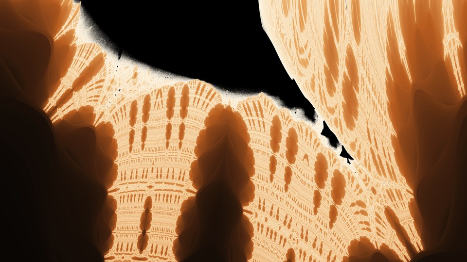
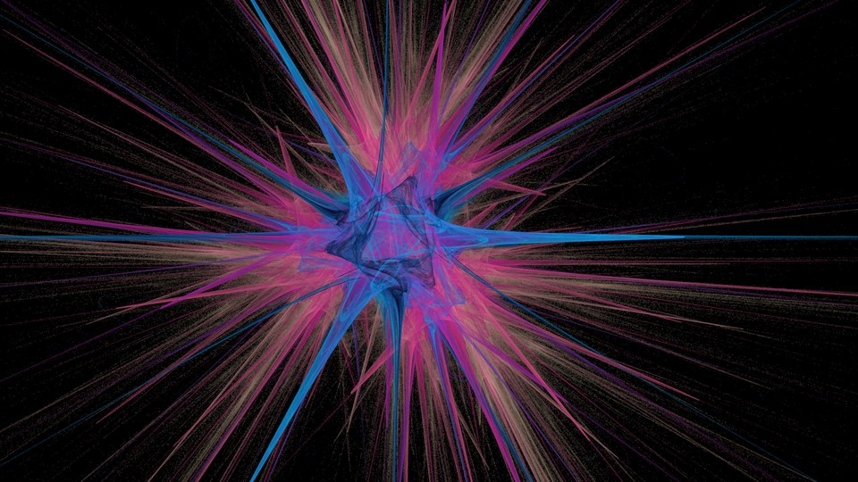
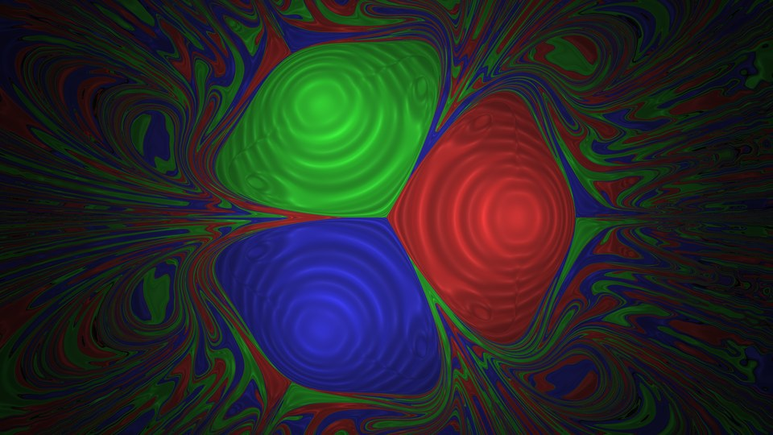
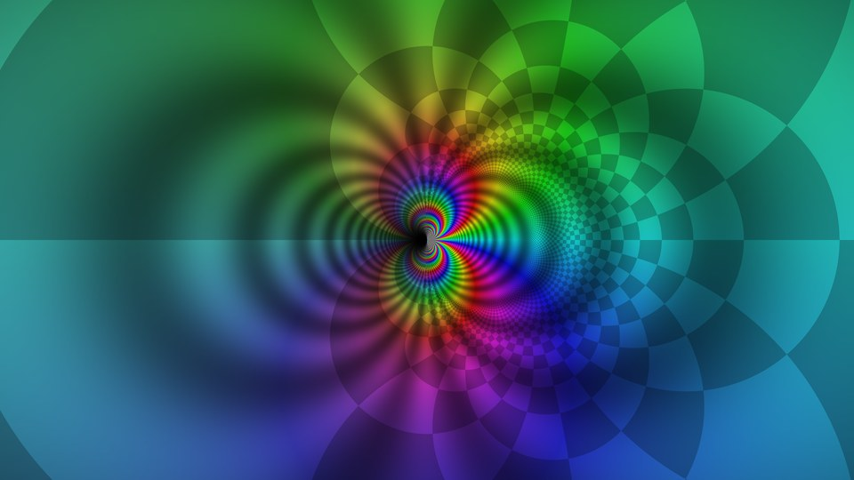

<p align="center">
  
</p>

<h3 align="center">Math, as wallpaper.</h3>

<p align="center">
  A fractal and dynamical-systems wallpaper generator with a live GUI,<br>
  129 built-in looks, and recipes you can fork. Any screen, up to 16K.
</p>

<p align="center">
  
  
  
  
</p>

<p align="center">
  <a href="#quick-start">Quick start</a> ·
  <a href="#what-it-draws">What it draws</a> ·
  <a href="#gallery">Gallery</a> ·
  <a href="#the-gui">The GUI</a> ·
  <a href="#customizing-a-render">Recipes</a> ·
  <a href="#extending">Extending</a> ·
  <a href="#batch-rendering">Batch rendering</a>
</p>

## Quick start

```sh
python -m venv .venv && .venv/bin/pip install -e .
fractalgen gui                                   # pick, tweak and save in your browser
fractalgen list -l                               # every look, with its generator and palette
fractalgen render julia_dragon --size 3840x2160  # one wallpaper
fractalgen render --preset 8k iphone             # a batch: presets pick looks by tag
```

`python -m fractalgen` is the same command. Pictures land in `backgrounds/`, and every
file carries its full recipe, so you can fork a wallpaper back from the image itself.

<p align="center">
  
</p>

## What it draws

Sixteen families of math, each with its own generator and several tuned looks. One of each,
rendered by the current code:

<table>
<tr>
<td align="center" width="25%"><br><b>Escape-time</b><br><sub><code>mandelbrot_spiral</code></sub></td>
<td align="center" width="25%"><br><b>Buddhabrots</b><br><sub><code>buddhabrot_nebula</code></sub></td>
<td align="center" width="25%"><br><b>Newton basins</b><br><sub><code>newton_star</code></sub></td>
<td align="center" width="25%"><br><b>Lyapunov space</b><br><sub><code>lyapunov_aurum</code></sub></td>
</tr>
<tr>
<td align="center" width="25%"><br><b>Domain coloring</b><br><sub><code>domain_sin_inv</code></sub></td>
<td align="center" width="25%"><br><b>Fractal flames</b><br><sub><code>flame_bloom</code></sub></td>
<td align="center" width="25%"><br><b>Strange attractors</b><br><sub><code>lorenz_butterfly</code></sub></td>
<td align="center" width="25%"><br><b>Orbit maps</b><br><sub><code>hopalong</code></sub></td>
</tr>
<tr>
<td align="center" width="25%"><br><b>IFS fractals</b><br><sub><code>barnsley_fern</code></sub></td>
<td align="center" width="25%"><br><b>Reaction-diffusion</b><br><sub><code>gray_scott_coral</code></sub></td>
<td align="center" width="25%"><br><b>Slime mold</b><br><sub><code>physarum_biolum</code></sub></td>
<td align="center" width="25%"><br><b>Sandpiles</b><br><sub><code>sandpile_ice</code></sub></td>
</tr>
<tr>
<td align="center" width="25%"><br><b>Hyperbolic tilings</b><br><sub><code>poincare_ember</code></sub></td>
<td align="center" width="25%"><br><b>Harmonographs</b><br><sub><code>harmonograph_gold</code></sub></td>
<td align="center" width="25%"><br><b>Caustics</b><br><sub><code>caustics_pool</code></sub></td>
<td align="center" width="25%"><br><b>KAM islands</b><br><sub><code>standard_map_golden</code></sub></td>
</tr>
</table>

Everything that shapes a picture is data you can change: generator parameters, palettes,
framing (center, zoom and rotation), camera angles, finishing effects, and layers of text,
shapes and images painted over the render or cut out of it.

## Gallery

<table>
<tr>
<td width="50%"><br><sub><code>julia_dragon</code></sub></td>
<td width="50%"><br><sub>A Julia zoom made in the GUI</sub></td>
</tr>
<tr>
<td width="50%"><br><sub><code>newton_sextic</code></sub></td>
<td width="50%"><br><sub><code>julia_snowflake</code></sub></td>
</tr>
<tr>
<td width="50%"><br><sub><code>clifford_gold</code></sub></td>
<td width="50%"><br><sub>A flow attractor made in the GUI</sub></td>
</tr>
<tr>
<td width="50%"><br><sub><code>lyapunov_baba</code></sub></td>
<td width="50%"><br><sub><code>mandelbrot_seahorse</code></sub></td>
</tr>
<tr>
<td width="50%"><br><sub><code>burning_ship_cathedral</code></sub></td>
<td width="50%"><br><sub>An attractor burst made in the GUI</sub></td>
</tr>
<tr>
<td width="50%"><br><sub><code>magnetic_pendulum_tri</code></sub></td>
<td width="50%"><br><sub><code>domain_exp</code></sub></td>
</tr>
</table>

The header is the engine rendering its own name: `julia_dragon` cut into type with a glow,
a bevel, and a dimmed copy of itself behind the letters. `python docs/render_assets.py`
rebuilds it, and `--looks` rebuilds the family grid above.

## The GUI

`fractalgen gui` opens a local page built for making a wallpaper quickly:

- **Pick a look** from the gallery (thumbnails, search, categories), step through them
  with the arrows (or `[` / `]`) or hit Surprise me. **Variations** shows eight random tweaks to choose from.
- **Screen**: previews in your screen's exact shape by default; switch to a phone, an
  ultrawide or any preset. Looks frame themselves for each shape.
- Tabs: **Look** (the main settings up front, every other parameter under More settings),
  **Frame** (drag to pan, scroll to zoom, Shift+scroll or Alt+drag to turn), **Color**
  (palette swatches, brightness / contrast / saturation / hue / vignette, exposure),
  **Layers** (add text, shapes or an uploaded image, drag them on the picture, style
  presets like Neon or Emboss) and **Effects** (an ordered, reorderable stack with presets
  like Film or Dreamy).
- **Compare** (or hold `\`) shows the look as it was loaded; undo / redo cover every edit,
  including switching screen shapes; the URL keeps your edits.
- **Save wallpaper** renders at full size (this screen, 4K, 8K, phone and more), with
  optional 2× / 3× supersampling for smoother edges. It either downloads straight to your
  browser (nothing kept in the project) or saves to `backgrounds/gui/` with **Show in
  Finder** (or your file manager); the choice is remembered. **Save as recipe**
  writes `custom/NAME.toml`. `?` lists the keyboard shortcuts.

## Concepts

| Thing | What it is | Where it lives |
|---|---|---|
| **generator** | an algorithm: `fn(ctx, *, **params) -> RGB`. Its keyword args *are* its schema | `fractalgen/generators/*.py` |
| **recipe** | a named look: generator + params + palette + view + tone + post + tags | `fractalgen/data/recipes/*.toml` |
| **palette** | gradient stops (optionally positioned) | `fractalgen/data/palettes.toml` |
| **view** | complex-plane window (Lyapunov: the (a, b) plane): `center`, `half_width`, `rotation` (deg), `fit` | recipe `view = {...}` |
| **tone** | adjusts a generator's automatic exposure before the palette: `black`, `white`, `curve`, `per_frame` (see below) | recipe `tone = {...}` |
| **post** | an ordered list of finishing effects for *any* render: brightness, contrast, saturation, hue, tint, vignette, bloom, grain, blur, sharpen, chromatic aberration, gradients, recolor, ... (see below) | recipe `[[post]]` tables (or `post = {...}`) |
| **layers** | any number of text, shape and image layers, painted on top or cut from the render, over a `background` (see below) | recipe `[[layers]]` tables (or one `mask = {...}`) |
| **formula registries** | escape-time formulas, 2D maps, 3D flows, vector fields, domain functions | Python or TOML |
| **preset** | output size + default recipe selection + memory caps | `fractalgen/data/presets.toml` |

`python -m fractalgen generators NAME` lists every parameter of a generator with its
default and documentation; `python -m fractalgen show RECIPE` shows a recipe's resolved
values (`~` marks generator defaults).

## Customizing a render

From quickest to most permanent:

```sh
# 1. One-off overrides on any render
python -m fractalgen render julia_dragon --size 1920x1080 \
    --set max_iter=900 --set c=-0.79+0.16j --palette aurora_r \
    --center -0.1+0.2j --zoom 2 --rotate 30 \
    --tone white=0.85 --post saturation=1.3 --post vignette=0.35

# 2. Explore one knob: renders julia_dragon@max_iter=200.png, ...
python -m fractalgen render julia_dragon --size 960x540 --sweep max_iter=200,400,800
python -m fractalgen render clifford_gold --size 960x540 --sweep post.hue_shift=0,60,120

# 3. Live: sliders for every parameter, drag to pan, wheel to zoom, save as recipe
python -m fractalgen gui

# 4. Fork into an editable file with EVERY parameter spelled out and documented
python -m fractalgen fork physarum_dark_matter my_slime   # -> custom/my_slime.toml
python -m fractalgen render my_slime --size 3840x2160

# 5. Every PNG / JPEG fractalgen writes embeds the full look; fork it back from the image
python -m fractalgen fork backgrounds/gui/julia_dragon_3840x2160.png dragon_again
```

The embedded recipe (`fractalgen.recipe` text chunk, or a JSON comment in JPEGs) includes
every override: palette, params, view, post, tone and mask. A look saved from a pan or zoom
of another recipe records `tone_from = "that_recipe"`, so it keeps that recipe's exposure
rather than re-measuring on the new view.

`custom/` is loaded automatically. In a recipe file, small tweaks don't need a full copy:

```toml
[recipe.dragon_night]
extends = "julia_dragon"            # inherit everything but tags/description, override a little
palette = "abyss"
post = { exposure = -0.3, vignette = 0.4 }

[recipe.dragon_night.variants.tilted]   # renders as dragon_night@tilted
view = { rotation = 25, half_width = 0.9 }
post = { hue_shift = 40 }

[recipe.dragon_night.portrait]          # merged in when height > width (phones)
view = { center = [-0.2, 0.25], half_width = 0.6, fit = "fill" }
```

### Tone

Most generators stretch their raw values (iteration counts, orbit hits, densities) to
the screen automatically: a histogram or percentile range measured from the pixels.
That measurement is taken once, on the recipe's own view, and frozen as the look's
default tone. Panning, zooming or resizing (in the GUI or with `--center` / `--zoom`)
then keeps the same exposure instead of re-measuring every frame. `tone` adjusts that
stretch before the palette is applied (`post` works afterwards, on the final colors):

```toml
tone = { black = 0.05, white = 0.9, curve = 1.3 }   # omitted keys keep the default
```

`black` / `white` clip the stretch (0..1), `curve` bends the midtones (>1 brighter), and
`per_frame = true` brings back re-measuring on every frame, which is handy for deep zooms
past where the default's range runs out. `python -m fractalgen tone` lists them;
`--sweep tone.white=1,0.8,0.6` explores one. Generators with no automatic stretch
(domain coloring, for instance) ignore `tone`.

### Layers: text, shapes and images

A recipe can stack any number of layers, drawn bottom to top. Each one is a `text`,
`shape` or `image` with its own placement, fill and style:

```toml
[recipe.dragon_title]
extends = "julia_dragon"
background = { fill = "self", dim = 0.15, blur = 24 }   # behind cut-out layers

[[recipe.dragon_title.layers]]
type = "text"
text = "FRACTAL"          # fill defaults to "fractal": the render shows through the letters
glow = 0.7
bevel = 0.5
name = "title"

[[recipe.dragon_title.layers]]
type = "shape"
shape = "heart"
fill = "ff3366"           # a solid heart painted on top
size = 0.12
x = 0.9
y = 0.12
shadow = 0.5

[recipe.dragon_title.portrait]
layers = { title = { text = "FRAC\nTAL" } }   # phones: patch a layer by name (or index)
```

```sh
python -m fractalgen render julia_dragon --size 3840x2160 \
    --layer 'type="text", text="HELLO", font="Avenir Next Heavy", outline=6' --background fill=self
python -m fractalgen render julia_dragon --size 2048x2048 \
    --layer 'type="image", image="logo.png", size=0.3, y=0.85'     # paint a logo on top
python -m fractalgen mask                                            # every key, documented
```

<details>
<summary>Every layer key</summary>

- **kind**: `text` (`\n` breaks lines; `font` takes a family name like `"Arial Black"` or
  `"Avenir Next Heavy"`, or a font file), `shape` (circle, ring, heart, star, hexagon,
  rounded, rectangle, diamond, triangle, crescent, plus any registered with `fg.shape`), or
  `image` (a PNG with transparency works best).
- **fill**: `"fractal"` (the render shows through: a cut-out; the default for text and
  shapes), a hex color, `"palette:NAME"` (a top-to-bottom gradient), `"recipe:NAME"`
  (another look), or `"image"` (an image layer's own pixels; its default).
- **where**: `size` (fraction of the frame it fits in), `x` / `y` (0..1, from the top
  left), `rotate`, `invert`, `feather`.
- **style**: `opacity`, `blend` (normal, multiply, screen, overlay, soft_light, add,
  difference, lighten, darken), `outline` + `outline_color`, `glow` + `glow_radius`,
  `shadow`, `bevel`, and `enabled = false` to keep a layer but hide it.
- **background** (shown when any layer is a cut-out): `fill` = a hex color, `transparent`,
  `self` (the render itself, dimmed by `dim`, softened by `blur`), `recipe:NAME`, or
  `palette:NAME`.

</details>

Layers run before `post`, so effects finish the whole frame. Lengths are pixels at 4K, so
previews match exports. The older single-layer form still works and renders the same:
`mask = { text = "FRACTAL", glow = 0.7, background = "self", background_dim = 0.12 }` with
`--mask key=value`. Built-in examples: `seahorse_porthole`, `snowflake_star`, `dragon_lettering`.

### Effects

`post` is an ordered list: each effect works on the result of the one before, so the same
effect can appear twice and order matters. Every effect also takes `mix` (0..1, blend with
its input) and `enabled`:

```toml
[[recipe.NAME.post]]
op = "bloom"
amount = 0.6
radius = 80

[[recipe.NAME.post]]
op = "grain"
amount = 0.05

[[recipe.NAME.post]]
op = "vignette"
value = 0.35
```

The short table form still works and runs in a fixed order:
`post = { exposure = 0.3, saturation = 1.2, vignette = 0.35 }`. On the command line,
`--post vignette=0.35` sets one effect, `--effect 'op="bloom", amount=0.5'` appends one, and
`--no-post` drops the recipe's own. `python -m fractalgen post` lists every effect and its
parameters.

<table>
<tr><td><b>Palettes</b></td><td>a name (<code>"ember"</code>), reversed (<code>"ember_r"</code>), inline stops (<code>["000000", "ff6a00", "fff3d6"]</code>), or <code>{ stops = [...], positions = [0, 0.3, 1] }</code></td></tr>
<tr><td><b>Angles</b></td><td>degrees (<code>30</code>), or strings like <code>"0.72rad"</code> and <code>"pi/6"</code></td></tr>
<tr><td><b>Complex numbers</b></td><td><code>[re, im]</code> or <code>"-0.8+0.156j"</code></td></tr>
</table>

## Same picture at every size

Every look is defined at a 4K reference frame (3840×2160's pixel count, at your
frame's aspect), so a 720p preview, a 4K wallpaper and a 16K export show the same
picture, only sharper:

- simulations (reaction-diffusion, slime mold, sandpiles) run on
  a grid sized from the reference and are upsampled; repeated renders with the same
  simulation parameters reuse the result in-process, so recoloring is instant;
- particle and line renders put their hit counts on the reference's scale before tone
  mapping, so brightness doesn't drift with resolution;
- lengths documented as "pixels at 4K" scale with the output.

Output at exactly 3840×2160 is unchanged by this. Simulations cost the same at every
output size (a preview takes as long to simulate as a 4K render).

## Extending

### Without Python (TOML in `custom/`, `--load PATH`, or `$FRACTALGEN_PATH`)

```toml
[palette.sunset]
stops = ["000000", "ff5500", "ffd27f", "ffffff"]
positions = [0, 0.3, 0.8, 1]

[formula.sine_julia]          # escape-time formula, compiled to numba
z = "c * sin(z)"              # names: z, c, zp (previous z), k, sin/cos/exp/log/sqrt/abs/conj/re/im
julia = true                  # pixel is z0 (else pixel is c)
degree = 1.0                  # polynomial degree for smooth coloring (<= 1: plain counts)
bailout = 50.0

[recipe.sine_glow]
generator = "escape_time"
palette = "sunset"
view = { center = [0, 0], half_width = 3.5, rotation = 30 }
params = { formula = "sine_julia", c = [1.0, 0.1], max_iter = 120 }
```

<details>
<summary>2D maps, 3D flows, vector fields and domain functions</summary>

```toml
[map.my_map]                  # 2D iterated map for map_attractor
x = "sin(a*y) - cos(b*x)"
y = "sin(c*x) - cos(d*y)"
params = { a = 1.4, b = -2.3, c = 2.4, d = -2.1 }

[flow.my_flow]                # 3D ODE for flow_attractor
dx = "s*(y - x)"
dy = "x*(r - z) - y"
dz = "x*y - b*z"
params = { s = 10.0, r = 28.0, b = 2.667 }

[vectorfield.my_field]        # 2D field for flow_field (variables px, py)
vx = "sin(a*py) + cos(px)"
vy = "cos(px*py)"
params = { a = 1.7 }

[domain.my_fn]                # complex function for domain_color (variable z)
w = "(z**3 - a) / (z**2 + 1)"
params = { a = 1.0 }
```

</details>

See `examples/extensions.toml` for a runnable version.

### With Python (a `.py` file in `custom/`, or `--load plugin.py`)

```python
import numpy as np
import fractalgen as fg

@fg.generator("ripples", category="fields", uses_view=True,
              param_docs={"waves": "number of wave sources"}, ranges={"waves": (1, 20, 1)})
def ripples(ctx, *, waves: int = 5, freq: float = 12.0, palette="abyss", seed: int = 1):
    """Interfering circular waves."""
    re, im = ctx.plane()                    # honors center / zoom / rotation / fit
    rng = np.random.default_rng(seed)
    amp = sum(np.sin(freq * np.hypot(re - x, im - y)) for x, y in rng.uniform(-1, 1, (waves, 2)))
    return fg.sample_palette(palette, fg.histogram_index(amp, np.ones_like(amp, bool)))

@fg.post_op("scanlines", "Darken every other band of rows (0 = off)", neutral=0.0, range=(0.0, 1.0))
def scanlines(rgb, amount, ctx):
    rows = (np.arange(rgb.shape[0]) // 3) % 2
    return rgb * (1.0 - amount * rows)[:, None, None]
```

Effects with several parameters take a schema (`fg.Key`) and get a dict; new shapes
are a signed distance function:

```python
@fg.effect("duotone", "Map brightness onto two colors", category="color", params={
    "dark": fg.Key("Shadow color", "1b1035", "color"),
    "light": fg.Key("Highlight color", "ffd27a", "color"),
})
def duotone(rgb, p, ctx):
    ...

@fg.shape("drop", "A teardrop")
def drop(x, y):                          # x, y scaled so radius 1 fills the layer box
    return np.hypot(x, y + 0.2 * y.clip(0)) - 1.0
```

Other hooks: `fg.layer_type` (a new kind of layer), `fg.register_palette`, `fg.register_formula` (numba step
`f(z, c, zp, k) -> complex`), `fg.register_map`, `fg.register_flow`,
`fractalgen.generators.fields.register_vector_field`, `register_domain`,
`fractalgen.loader.section("name")` for brand-new TOML tables, and
`fg.Recipe(...)` / `fg.register_recipe` to build looks in code.
Long generators can call `fractalgen.progress.update(fraction)` inside their loops
so export and batch progress bars move (see `fractalgen/progress.py`).
New generators automatically appear in the CLI, `fork`, and the GUI (with sliders
from `ranges` and dropdowns from `choices`).

Scaffold without hand-copying:

```sh
python -m fractalgen new generator my_waves --view    # -> custom/my_waves.py + .toml
python -m fractalgen new post my_grade
python -m fractalgen new palette sunset --stops 000000,ff5500,ffd700,ffffff
```

A third-party package can register hooks with a `fractalgen.plugins` entry point
(see `examples/pip_plugin/`).

## Batch rendering

```sh
python -m fractalgen presets
python -m fractalgen render --preset 4k                 # everything at 3840x2160
python -m fractalgen render --preset 8k iphone-8k       # tag "keep"
python -m fractalgen render --preset 16k                # tag "vip", JPEG
python -m fractalgen render --preset 8k --tag vip --skip-existing --jobs 1
python -m fractalgen render --preset super-ultrawide julia_dragon   # 5120x1440, one picture
```

| Preset | Size | | Preset | Size |
|---|---|---|---|---|
| `4k` | 3840×2160 | | `iphone` | 1290×2796 |
| `5k` | 5120×2880 | | `iphone-8k` | 3840×8320 |
| `8k` | 7680×4320 | | `iphone-16k` | 7680×16640 |
| `16k` | 15360×8640 | | `ipad` | 2048×2732 |
| `macbook` | 3456×2234 | | `ultrawide` | 3440×1440 |
| `dual-4k` | 7680×2160 | | `ultrawide-5k` | 5120×2160 |
| `triple-4k` | 11520×2160 | | `super-ultrawide` | 5120×1440 |

`dual-4k` and `triple-4k` are one picture spanning several monitors. `--size` overrides a
preset's size but keeps its tags and format, and the GUI's Screen menu lists every preset.

Each recipe renders in its own process with a timeout (`--timeout`), so an OOM or a
runaway render skips that wallpaper instead of the batch. Per-pixel kernels render in
row strips at 8K/16K to bound memory. Output: `backgrounds/<preset>/<recipe>.png`.
On a terminal, a live line shows each running recipe's progress and elapsed time.

Tags: `keep` (8K-worthy), `vip` (16K-worthy), `draft` (weaker looks, skipped by `--all --exclude-tag draft`).

## Python API

```python
import fractalgen as fg
fg.bootstrap()
rgb = fg.render("julia_dragon", 1920, 1080)
fg.save_image("dragon.png", rgb)
```

`overrides` on `fg.render` may hold `params`, `view`, `palette`, `tone`, `post`,
`layers`, `background` and `mask`, the same things as the CLI flags.

## Development

```sh
python -m unittest discover tests        # unit tests + smoke-render every recipe
python tools/parity.py BASELINE_DIR      # compare against old-code renders
python tools/gui_check.py --all          # drive the GUI in headless Chromium (needs playwright)
python -m fractalgen doctor              # versions + a tiny smoke render
```

`tools/parity.py` compares small renders; since the resolution-independence work,
particle and simulation recipes match the old code at 3840×2160 only (smaller sizes
now look like the 4K render instead of differing from it).

Numba kernels intentionally skip numba's on-disk cache: with `fastmath`, a
cache-loaded kernel can round differently from a fresh compile and flip chaotic
boundary pixels, so identical recipes rendered differently between runs. Compiling
costs a second or two per process.

See [CONTRIBUTING.md](CONTRIBUTING.md) for how to add a look or a generator.

## History

fractalgen started as a few hard-coded scripts (`generate.py`, `ultra.py`, `bg/`), kept on
the `old-code` branch. Every recipe reproduces their 4K output pixel for pixel except
`physarum_dark_matter`, which is now simulated on all cores; other sizes match the 4K
picture (see [Same picture at every size](#same-picture-at-every-size)).

<details>
<summary>Old commands and their replacements</summary>

| old command | new command |
|---|---|
| `python generate.py` | `python -m fractalgen render --preset 4k` |
| `python generate.py --only a b` | `python -m fractalgen render a b --size 3840x2160` |
| `python ultra.py --preset 8k` (tier keep) | `python -m fractalgen render --preset 8k` |
| `python ultra.py --tier vip` | `... --tag vip` |
| `python ultra.py --tier all` | `... --all --exclude-tag draft` |
| `python render.py --preset desktop-8k` | `python -m fractalgen render --preset desktop-8k` |

</details>

## License

[MIT](LICENSE). See [CHANGELOG.md](CHANGELOG.md) for release notes.
