<p align="center">
  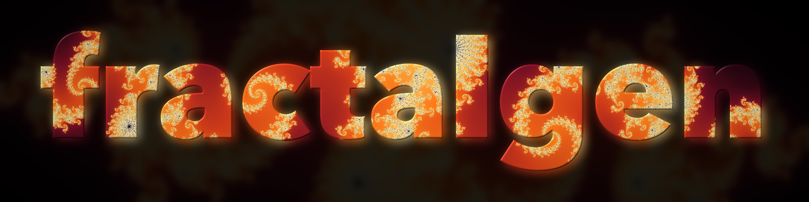
</p>

<h3 align="center">Math, as wallpaper.</h3>

<p align="center">
  A fractal and dynamical-systems wallpaper generator with an interactive GUI,<br>
  129 built-in looks, and customizable recipes. Any screen, up to 16K.
</p>

<p align="center">
  
  
  
  
</p>

<p align="center">
  <a href="#quick-start">Quick start</a> ·
  <a href="#what-it-draws">What it draws</a> ·
  <a href="#the-gui">The GUI</a> ·
  <a href="#customizing-a-render">Recipes</a> ·
  <a href="#extending">Extending</a> ·
  <a href="#batch-rendering">Batch rendering</a>
</p>

## Quick start

```sh
python -m venv .venv && .venv/bin/pip install -e .
fractalgen gui                                   # interactive browser UI
fractalgen list -l                               # list available looks
fractalgen render julia_dragon --size 3840x2160  # render a wallpaper
fractalgen render --preset 8k iphone             # batch render presets
```

Renders save to `backgrounds/`. Every exported image embeds its full recipe metadata, so you can inspect or fork a look directly from the image file.

<p align="center">
  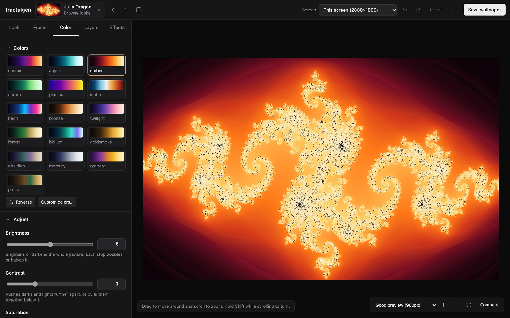
</p>

## What it draws

Sixteen mathematical families with tuned presets:

<table>
<tr>
<td align="center" width="25%">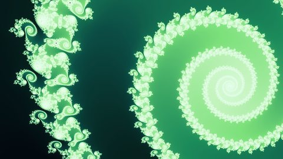<br><b>Escape-time</b><br><sub><code>mandelbrot_spiral</code></sub></td>
<td align="center" width="25%">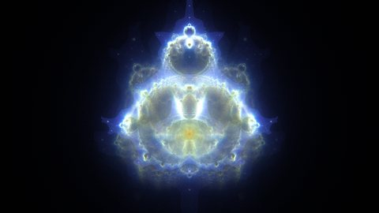<br><b>Buddhabrots</b><br><sub><code>buddhabrot_nebula</code></sub></td>
<td align="center" width="25%">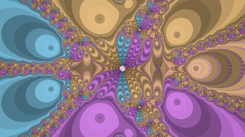<br><b>Newton basins</b><br><sub><code>newton_star</code></sub></td>
<td align="center" width="25%">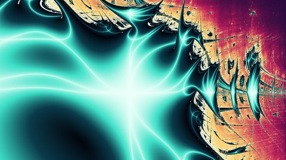<br><b>Lyapunov space</b><br><sub><code>lyapunov_aurum</code></sub></td>
</tr>
<tr>
<td align="center" width="25%">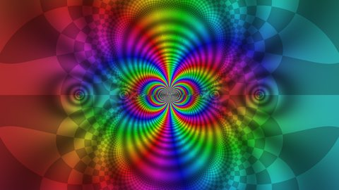<br><b>Domain coloring</b><br><sub><code>domain_sin_inv</code></sub></td>
<td align="center" width="25%">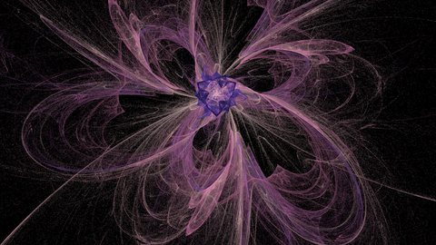<br><b>Fractal flames</b><br><sub><code>flame_bloom</code></sub></td>
<td align="center" width="25%">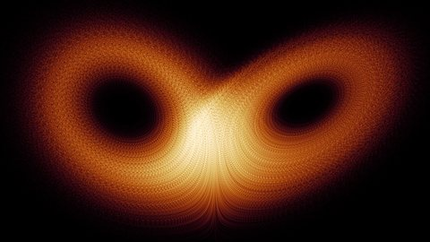<br><b>Strange attractors</b><br><sub><code>lorenz_butterfly</code></sub></td>
<td align="center" width="25%">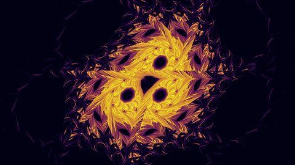<br><b>Orbit maps</b><br><sub><code>hopalong</code></sub></td>
</tr>
<tr>
<td align="center" width="25%">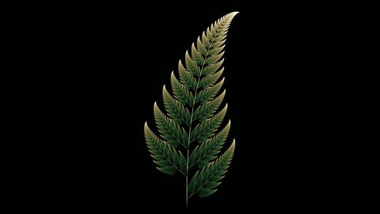<br><b>IFS fractals</b><br><sub><code>barnsley_fern</code></sub></td>
<td align="center" width="25%">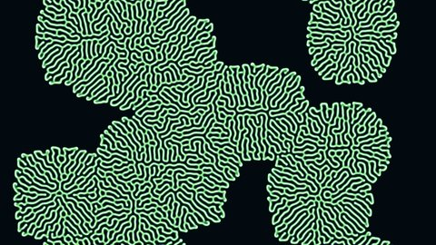<br><b>Reaction-diffusion</b><br><sub><code>gray_scott_coral</code></sub></td>
<td align="center" width="25%">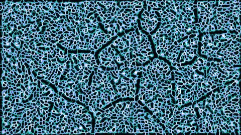<br><b>Slime mold</b><br><sub><code>physarum_biolum</code></sub></td>
<td align="center" width="25%">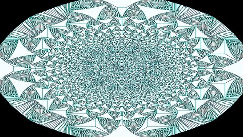<br><b>Sandpiles</b><br><sub><code>sandpile_ice</code></sub></td>
</tr>
<tr>
<td align="center" width="25%">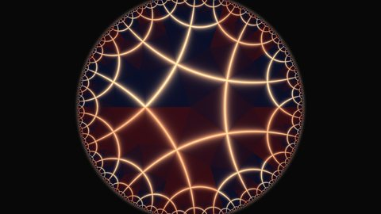<br><b>Hyperbolic tilings</b><br><sub><code>poincare_ember</code></sub></td>
<td align="center" width="25%">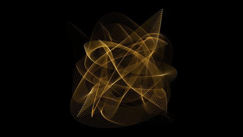<br><b>Harmonographs</b><br><sub><code>harmonograph_gold</code></sub></td>
<td align="center" width="25%">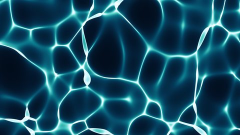<br><b>Caustics</b><br><sub><code>caustics_pool</code></sub></td>
<td align="center" width="25%">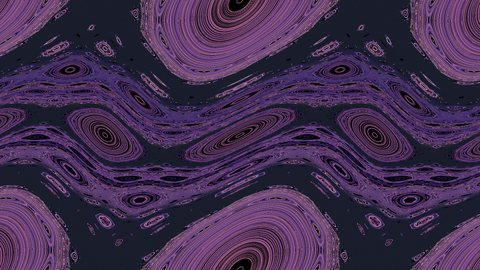<br><b>KAM islands</b><br><sub><code>standard_map_golden</code></sub></td>
</tr>
</table>

<details>
<summary>More gallery examples</summary>

<table>
<tr>
<td width="50%">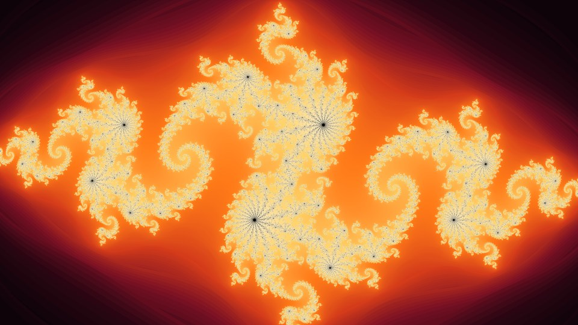<br><sub><code>julia_dragon</code></sub></td>
<td width="50%">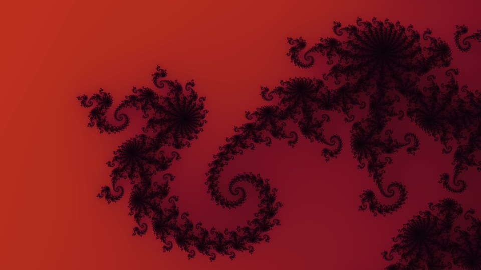<br><sub>Julia zoom</sub></td>
</tr>
<tr>
<td width="50%">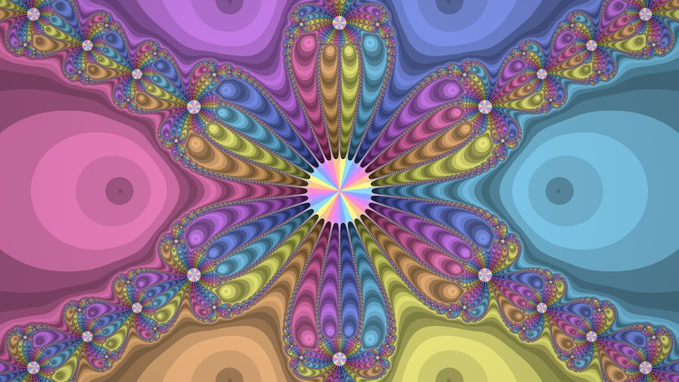<br><sub><code>newton_sextic</code></sub></td>
<td width="50%">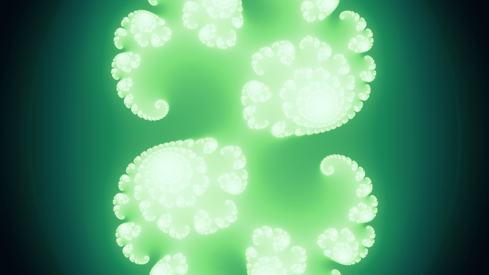<br><sub><code>julia_snowflake</code></sub></td>
</tr>
<tr>
<td width="50%">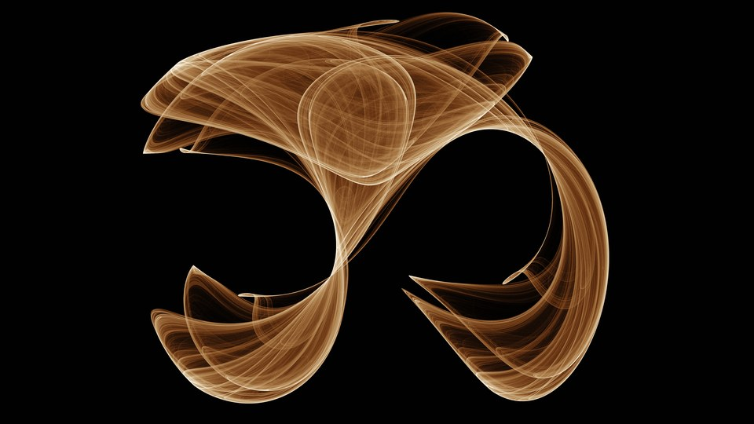<br><sub><code>clifford_gold</code></sub></td>
<td width="50%">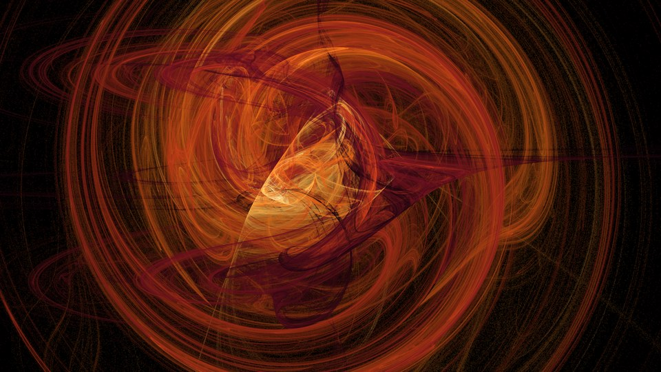<br><sub>Flow attractor</sub></td>
</tr>
<tr>
<td width="50%">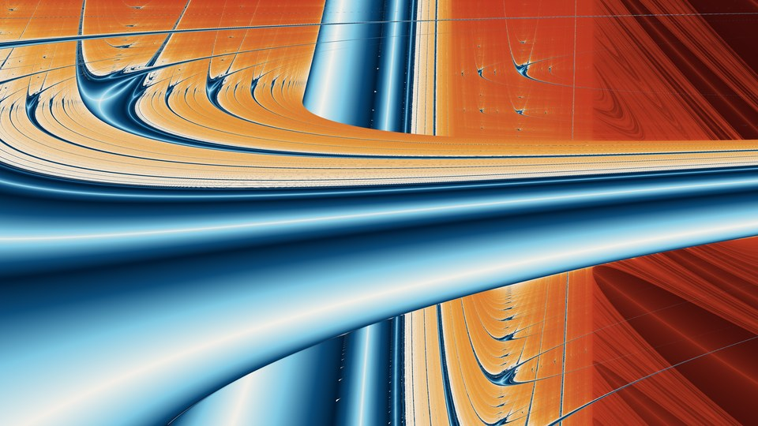<br><sub><code>lyapunov_baba</code></sub></td>
<td width="50%">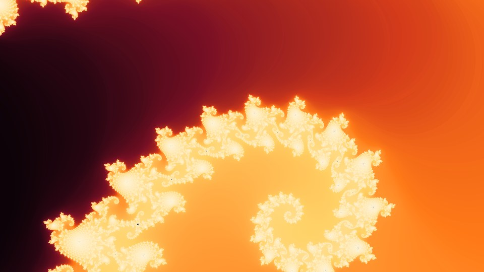<br><sub><code>mandelbrot_seahorse</code></sub></td>
</tr>
</table>

</details>

## The GUI

Run `fractalgen gui` to launch the local web interface:

- **Look selection**: Browse thumbnails, search, or click **Variations** for random tweaks.
- **Framing**: Pan, zoom, and rotate interactively. Framing adapts automatically to your screen or chosen preset.
- **Controls**: Tweak math parameters in **Look**, palettes and exposure in **Color**, text and shape overlays in **Layers**, and filter stacks in **Effects**.
- **Comparison & History**: Hold `\` to compare with the initial preset. Full undo and redo history tracks all changes.
- **Exporting**: Click **Save wallpaper** to export at full resolution (with optional 2x/3x supersampling), or **Save as recipe** to create a custom TOML file.

## Concepts

| Concept       | Description                                                               | Defined in                       |
| ------------- | ------------------------------------------------------------------------- | -------------------------------- |
| **generator** | Core algorithm function: `fn(ctx, *, **params) -> RGB`                    | `fractalgen/generators/*.py`     |
| **recipe**    | Named look: generator + params + palette + view + tone + effects + layers | `fractalgen/data/recipes/*.toml` |
| **palette**   | Gradient color stops                                                      | `fractalgen/data/palettes.toml`  |
| **view**      | Coordinate framing: center, zoom, rotation, and aspect fit                | `view = {...}` in recipe         |
| **tone**      | Histogram/contrast normalization before color mapping                     | `tone = {...}` in recipe         |
| **post**      | Ordered post-processing filters (bloom, blur, grain, vignette)            | `[[post]]` tables in recipe      |
| **layers**    | Overlay elements (text, geometric shapes, images)                         | `[[layers]]` tables in recipe    |
| **preset**    | Target resolution paired with recipe filter tags                          | `fractalgen/data/presets.toml`   |

## Customizing a render

### CLI options

```sh
# Override view, palette, parameters, tone, and effects
python -m fractalgen render julia_dragon --size 1920x1080 \
    --set max_iter=900 --palette aurora_r \
    --center -0.1+0.2j --zoom 2 --rotate 30 \
    --tone white=0.85 --post saturation=1.3 vignette=0.35

# Parameter sweeps
python -m fractalgen render julia_dragon --size 960x540 --sweep max_iter=200,400,800

# Fork an existing look into an editable recipe
python -m fractalgen fork physarum_dark_matter my_slime   # writes custom/my_slime.toml
python -m fractalgen render my_slime --size 3840x2160

# Fork a recipe directly from an exported image
python -m fractalgen fork backgrounds/gui/julia_dragon_3840x2160.png dragon_again
```

### Recipe syntax

Recipes live in TOML files under `custom/` and load automatically. You can extend existing looks:

```toml
[recipe.dragon_night]
extends = "julia_dragon"
palette = "abyss"
post = { exposure = -0.3, vignette = 0.4 }

[recipe.dragon_night.portrait]          # applied when height > width
view = { center = [-0.2, 0.25], half_width = 0.6, fit = "fill" }
```

### Layers and effects

Recipes can composite multiple text, shape, or image layers, followed by an ordered chain of post-processing filters:

```toml
[recipe.dragon_title]
extends = "julia_dragon"
background = { fill = "self", dim = 0.15, blur = 24 }

[[recipe.dragon_title.layers]]
type = "text"
text = "FRACTAL"          # fill defaults to "fractal", showing the render through letters
glow = 0.7
bevel = 0.5

[[recipe.dragon_title.post]]
op = "bloom"
amount = 0.6
radius = 80

[[recipe.dragon_title.post]]
op = "vignette"
value = 0.35
```

Run `python -m fractalgen mask` to list layer options, and `python -m fractalgen post` for available effects.

## Extending fractalgen

### Via TOML (`custom/*.toml`)

Define new formulas, palettes, maps, and flows without writing Python:

```toml
[palette.sunset]
stops = ["000000", "ff5500", "ffd27f", "ffffff"]
positions = [0, 0.3, 0.8, 1]

[formula.sine_julia]
z = "c * sin(z)"
julia = true
degree = 1.0
bailout = 50.0

[recipe.sine_glow]
generator = "escape_time"
palette = "sunset"
view = { center = [0, 0], half_width = 3.5, rotation = 30 }
params = { formula = "sine_julia", c = [1.0, 0.1], max_iter = 120 }
```

See `examples/extensions.toml` for more examples (including 2D maps and 3D differential equations).

### Via Python (`custom/*.py`)

Create custom generators or post-processing filters:

```python
import numpy as np
import fractalgen as fg

@fg.generator("ripples", category="fields", uses_view=True,
              param_docs={"waves": "number of wave sources"}, ranges={"waves": (1, 20, 1)})
def ripples(ctx, *, waves: int = 5, freq: float = 12.0, palette="abyss", seed: int = 1):
    """Interference patterns from circular wave sources."""
    re, im = ctx.plane()
    rng = np.random.default_rng(seed)
    amp = sum(np.sin(freq * np.hypot(re - x, im - y)) for x, y in rng.uniform(-1, 1, (waves, 2)))
    return fg.sample_palette(palette, fg.histogram_index(amp, np.ones_like(amp, bool)))

@fg.post_op("scanlines", "Darken alternating row bands", neutral=0.0, range=(0.0, 1.0))
def scanlines(rgb, amount, ctx):
    rows = (np.arange(rgb.shape[0]) // 3) % 2
    return rgb * (1.0 - amount * rows)[:, None, None]
```

Scaffold templates with the CLI:

```sh
python -m fractalgen new generator my_waves --view
python -m fractalgen new post my_grade
python -m fractalgen new palette sunset --stops 000000,ff5500,ffd700,ffffff
```

## Batch rendering

```sh
python -m fractalgen presets                            # list size presets
python -m fractalgen render --preset 4k                 # render all 4K presets (3840x2160)
python -m fractalgen render --preset 8k iphone-8k       # render looks tagged "keep"
python -m fractalgen render --preset 16k                # render looks tagged "vip"
python -m fractalgen render --preset 8k --tag vip --jobs 4
```

| Preset    | Dimensions |     | Preset            | Dimensions |
| --------- | ---------- | --- | ----------------- | ---------- |
| `4k`      | 3840x2160  |     | `iphone`          | 1290x2796  |
| `5k`      | 5120x2880  |     | `iphone-8k`       | 3840x8320  |
| `8k`      | 7680x4320  |     | `ipad`            | 2048x2732  |
| `16k`     | 15360x8640 |     | `ultrawide`       | 3440x1440  |
| `macbook` | 3456x2234  |     | `super-ultrawide` | 5120x1440  |

Recipes render in isolated processes with memory-safe row stripping at 8K and 16K.

## Python API

```python
import fractalgen as fg

fg.bootstrap()
rgb = fg.render("julia_dragon", 1920, 1080)
fg.save_image("dragon.png", rgb)
```

## Development

```sh
python -m unittest discover tests   # unit tests and thumbnail smoke renders
python tools/parity.py BASELINE_DIR # verify output against reference baselines
python tools/gui_check.py --all     # browser GUI test (requires playwright)
python -m fractalgen doctor         # verify dependencies and test render
```

See [CONTRIBUTING.md](CONTRIBUTING.md) for contribution guidelines and [CHANGELOG.md](CHANGELOG.md) for release notes.

## License

[MIT](LICENSE)
